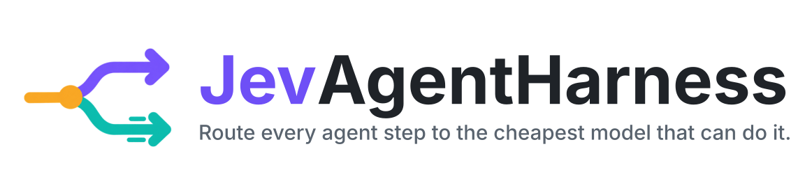
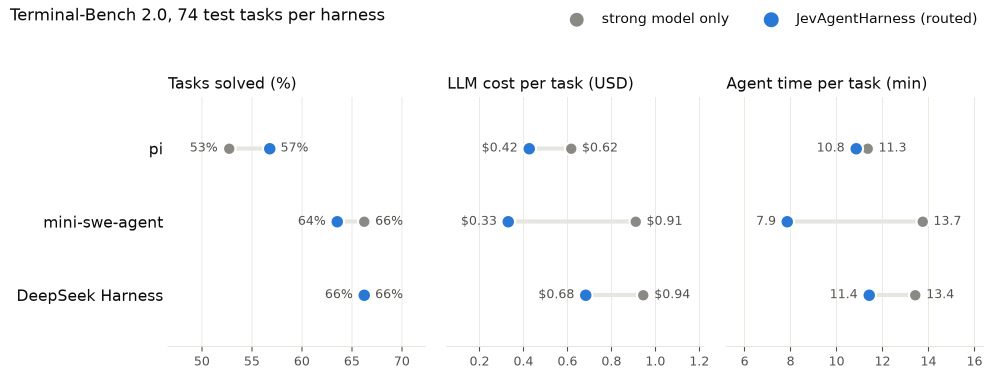
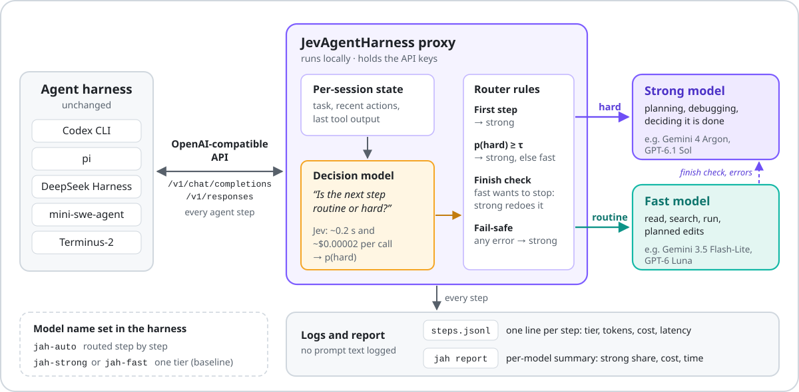
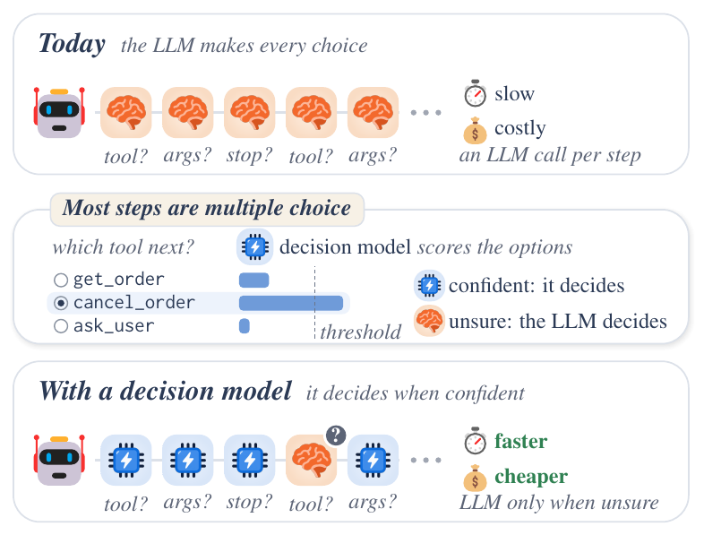

<div align="center">

<picture>
  <source media="(prefers-color-scheme: dark)" srcset="assets/banner-dark.svg">
  
</picture>

**A small decision model watches every step of your coding agent. Routine steps go to a cheap model, hard steps to
the strong one. Same results, a fraction of the bill.**

[](LICENSE)


[](paper/JevAgentHarness.pdf)
[](https://huggingface.co/JevAgentHarness)

[Results](#results) · [Quickstart](#quickstart) · [Harnesses](#connect-your-harness) · [How it works](#how-routing-works) ·
[Decision points](#decision-points-and-modes) · [Reproduce](bench/README.md) · [Models and data](#models-and-data) ·
[Paper (PDF)](paper/JevAgentHarness.pdf) · [Citation](#citation)

</div>

---

Coding agents call a frontier model at every step: to read a file, to run `ls`, to re-run a test. Most of those
steps are routine and a fast model does them just as well. A few steps decide the outcome: planning the fix,
debugging a failure, deciding that the task is done. **JevAgentHarness** keeps those on the strong model and moves the
rest to a fast one. It is a local OpenAI-compatible proxy, so the agent itself does not change.

On 74 held-out [Terminal-Bench 2.0](https://www.tbench.ai/) tasks, three unmodified harnesses stayed within 3 points
of their success rate on the strong model alone while spending **28–64% less on LLM calls** and finishing tasks
**4–43% faster**.

<div align="center">
<picture>
  <source media="(prefers-color-scheme: dark)" srcset="assets/results-dark.png">
  
</picture>
</div>

## How it works

<div align="center">
<picture>
  
</picture>
</div>

1. Your harness (Codex, pi, DeepSeek Harness, mini-swe-agent, Terminus-2, or any OpenAI-compatible client) sends
   each model call to the proxy instead of the provider.
2. The proxy asks a decision model one question about the agent's current state: *is the next step `routine` or
   `hard`?* With [Jev](https://openrouter.ai/typesafe/jev-1.13) this takes about 0.15 s and costs about $0.0001
   (a Terminal-Bench state is about 2,000 tokens).
3. Routine steps go to the fast model, hard steps to the strong model. The first step and the decision that the task
   is finished always go to the strong model, and any error falls back to it. (mini-swe-agent finishes with a shell
   command rather than a text reply: set `stop.submit` to cover it, see [docs/modes.md](docs/modes.md#stop).)
4. Every step is logged with its tier, tokens, cost and latency, so you can check the savings on your own tasks with
   `jah report`.

This is the "System 1 / System 2" idea from the paper: a fast, cheap model makes the many small calls about *who*
should act, and the strong model is used where it matters.

<details>
<summary><b>The idea in one figure (from the paper)</b></summary>
<br>
<div align="center"></div>
<sub>Icons: <a href="https://github.com/microsoft/fluentui-emoji">Microsoft Fluent Emoji</a> (MIT).</sub>
</details>

## Results

Terminal-Bench 2.0, 74 test tasks per harness, one run each. Strong model: Gemini 4 Argon (high thinking). Fast
model: Gemini 3.5 Flash-Lite. Decision model: Jev (`typesafe/jev-1.13`), threshold τ = 0.75. Each harness is
compared with the same harness on the strong model alone.

| Harness | Solved (strong only → routed) | Δ success [95% CI] | Cost per task | Time per task | Steps on strong model |
|---|---|---|---|---|---|
| mini-swe-agent | 66.2% → **63.5%** | −2.7 [−14.9, +8.1] | $0.91 → **$0.33** (−64%) | 13.7 → **7.9** min (−43%) | 45% |
| pi | 52.7% → **56.8%** | +4.1 [−6.8, +14.9] | $0.62 → **$0.42** (−31%) | 11.3 → **10.8** min (−4%) | 55% |
| DeepSeek Harness | 66.2% → **66.2%** | +0.0 [−8.1, +8.1] | $0.94 → **$0.68** (−28%) | 13.4 → **11.4** min (−15%) | 50% |
| Terminus-2 ¹ | 27.0% → **41.9%** | +14.9 [+4.1, +25.7] | $0.11 → $0.14 (+27%) | 22.6 → **16.1** min (−29%) | 44% |

Cost is the LLM bill logged by the proxy (list prices, cached tokens at the cached rate, decision-model calls
included). Time is the agent's wall-clock time per task. The intervals are paired bootstrap intervals over tasks; with
74 tasks they are wide, so read the success column as "no detectable loss", not as a gain.

¹ Terminus-2 talks to the model in plain JSON instead of tool calls, so the final-answer check does not apply. Many
Gemini 4 Argon calls in its baseline run took minutes and returned empty replies, and 53 of 74 baseline tasks hit the
agent timeout, which also makes the baseline look cheap. Treat this row as inconclusive.

Against the criteria registered before the test runs (success no more than 3 points lower, cost at least 40% lower,
time lower), mini-swe-agent meets all three. pi and DeepSeek Harness meet the success and time criteria and save
28–31%, short of the 40% target: about half of their steps were judged hard and stayed on the strong model.

**What did not work as well.** The protocol ([`bench/PROTOCOL.md`](bench/PROTOCOL.md)) was written before the test
runs, and every configuration we ran on the test split is reported:

| Setting (test split) | Success: strong only → routed | Cost saving | Time saving |
|---|---|---|---|
| Argon + **Gemini 3.8 Flash** (τ = 0.5), pi / DeepSeek Harness / mini-swe-agent | +4 to +8 points | 7–13% | 17–22% |
| Codex + GPT-6.1 Sol / GPT-6 Luna (τ = 0.5), 20 tasks | 85% → 85% | 6.5% | −47% (slower) |

Two things decide the saving. The first is the price gap between the tiers: Flash is only ~2.7× cheaper than Argon
per token and the fast model takes a few more steps, so routing kept or improved success but saved 7–13%; with
Flash-Lite (4–7× cheaper) the same router saved 28–64%. The second is how many steps stay on the strong model: in
every run the decision model sent about half of the steps there, so the strong model still dominates the bill.
With OpenAI's automatic prompt caching the strong model was already cheap per step, and switching models cost cache
hits and time. Pick a fast tier that is much cheaper than the strong one, and measure on your own tasks.

The summaries and per-task results behind these tables (success, cost, time, steps and strong-model share for every
trial) are in [`bench/results/`](bench/results); [`bench/README.md`](bench/README.md) shows how to rebuild them from
Harbor's results and the proxy's step log, and `bench/plot_results.py` draws the figure above.

## Quickstart

```bash
git clone https://github.com/JevAgentHarness/JevAgentHarness.git && cd JevAgentHarness
pip install -e .
export GEMINI_API_KEY=...              # the LLM tiers (Gemini by default; any OpenAI-compatible API works)
export OPENROUTER_API_KEY=...          # the decision model (Jev on OpenRouter); or use {type: rules}, no key
jah init                               # optional: writes ~/.jah/config.yaml (commented) to edit
jah serve                              # http://127.0.0.1:8787/v1, uses ~/.jah/config.yaml if it exists
```

The built-in configuration is the setting from the results table: Gemini 4 Argon and Gemini 3.5 Flash-Lite, Jev
as the decision model, τ = 0.75. If the decision model cannot be reached (for example a missing
`OPENROUTER_API_KEY`), every step falls back to the strong model and the step log says `decision_error`; run
`jah decide` once to check the key and the latency.

Then point your harness at `http://127.0.0.1:8787/v1` with any dummy key (the proxy holds the real ones) and use
the model name `jah-auto`. `jah setup <harness>` prints the snippet for your harness.

### Model names

| Model name | What it does |
|---|---|
| `jah-auto` | routed: the decision model picks the tier for every step |
| `jah-strong` | every step on the strong tier (your baseline) |
| `jah-fast` | every step on the fast tier |

Run the same task with `jah-strong` and `jah-auto` and compare them with `jah report`. Per-model overrides (for
example a different τ) are one line in the config; see [Configuration](#configuration).

## Connect your harness

<details open>
<summary><b>Codex</b> (OpenAI Responses API)</summary>

```toml
# ~/.codex/config.toml
model_provider = "jah"
model = "jah-auto"
web_search = "disabled"

[model_providers.jah]
name = "JevAgentHarness"
base_url = "http://127.0.0.1:8787/v1"
env_key = "JAH_API_KEY"
wire_api = "responses"
stream_idle_timeout_ms = 600000
```

```bash
JAH_API_KEY=jah codex exec --skip-git-repo-check "fix the failing test"
```

Codex only offers its full tool set (including the freeform `apply_patch` tool) to models it knows. For the `jah-*`
names, add the model catalog from [`bench/codex_catalog.json`](bench/codex_catalog.json) with
`model_catalog_json = "/path/to/codex_catalog.json"`; see [docs/harnesses.md](docs/harnesses.md).
</details>

<details>
<summary><b>DeepSeek Harness</b> (<code>dsh</code>)</summary>

```yaml
# jah.patch.yml
- id: llm-pi-ai
  config:
    providers:
      jah:
        api: openai-completions
        baseURL: "http://127.0.0.1:8787/v1"
        apiKeyEnv: JAH_API_KEY
        compat: {supportsStore: false}
        models:
          - {id: jah-auto, contextWindow: 1000000, maxTokens: 65536}
- id: agent-default-model
  config: {provider: jah, model: jah-auto}
```

```bash
JAH_API_KEY=jah dsh --profile headless --patch jah.patch.yml "fix the failing test" --json
```
</details>

<details>
<summary><b>pi</b></summary>

```json
// ~/.pi/agent/models.json
{"providers": {"jah": {"baseUrl": "http://127.0.0.1:8787/v1", "api": "openai-completions", "apiKey": "JAH_API_KEY",
  "models": [{"id": "jah-auto", "reasoning": true, "contextWindow": 1000000, "maxTokens": 65536}]}}}
```

```bash
JAH_API_KEY=jah pi --provider jah --model jah-auto "fix the failing test"
```
</details>

<details>
<summary><b>mini-swe-agent</b></summary>

```yaml
# jah.yaml
model:
  model_name: openai/jah-auto
  model_kwargs: {api_base: "http://127.0.0.1:8787/v1", api_key: jah}
  cost_tracking: ignore_errors    # litellm has no price for jah-*; the proxy logs the cost
```

```bash
mini -c mini.yaml -c jah.yaml -t "fix the failing test"
```
</details>

<details>
<summary><b>Terminus-2, OpenAI SDK, litellm, OpenHands, ...</b></summary>

```python
from openai import OpenAI
client = OpenAI(base_url="http://127.0.0.1:8787/v1", api_key="jah")
client.chat.completions.create(model="jah-auto", messages=[...], tools=[...])
```

For litellm-based agents use the model `openai/jah-auto` with `api_base="http://127.0.0.1:8787/v1"`.
</details>

More detail for each harness, including the per-session URL form `/s/<session>/v1`, is in
[docs/harnesses.md](docs/harnesses.md).

## How routing works

For step *t* of an agent session (the number of model turns already in the request):

1. **The opening step goes to the strong tier.** The agent reads the task and plans.
2. **Then the decision model reads the state:** the task, the last few actions, and the latest tool output. It
   answers one question: *is the agent's next step `routine` or `hard`?* A step is `hard` when something failed or
   behaved unexpectedly, a fix or plan must be worked out, the agent repeats itself, or it must judge whether the task
   is done. The step goes to the strong tier if p(hard) ≥ τ, otherwise to the fast tier.
3. **Final-answer check.** When the fast tier wants to end the turn (a reply with no tool call), the strong tier
   redoes that step, so "the task is done" is always the strong model's call. This applies to tool-calling harnesses.
4. **Fail-safe.** If the decision model times out or errors, the step goes to the strong tier. If a fast-tier call
   fails, the strong tier takes it. The agent never stops because of the router.

Sessions are identified by the client's session id when it sends one (Codex does), otherwise by a hash of the system
prompt and the task, plus the model name. Name them explicitly with the header `X-JAH-Session: <id>` or the base URL
`http://127.0.0.1:8787/s/<id>/v1`.

## Decision points and modes

Routing is one **decision point**. The paper studies several, each with **modes** that say who decides, and the proxy
offers the ones it can act on from between the harness and the provider:

| Point | Modes | What an acting mode does |
|---|---|---|
| `routing` | `cascade` (default), `guard`, `shadow`, `off` | picks the tier that writes the step (above), or lets the fast tier write it and has the decision model check the result |
| `tool_select` | `cascade`, `assist`, `guard`, `shadow` | forces a confidently predicted tool and lets the fast tier fill in the arguments, shortlists the tools sent to the LLM, or has the strong tier redo a step whose tool it doubts |
| `stop` | `strong` (default), `guard`, `trigger`, `shadow` | the finish check above, or accepts the fast tier's final answer when the decision model is confident the task is done |
| `reflection` | `trigger`, `always`, `shadow` | sends a step to the strong tier with a note to re-check when the agent looks stuck |
| `action` | `guard`, `shadow` | gives risky calls (`rm -rf`, `git push --force`, `DROP TABLE`, deploys, ...) a second look on the strong tier |

```bash
jah serve --preset shadow       # every point logs its answer next to what the agent did; nothing changes
jah fit ~/.jah/logs             # fit each point's threshold on those logs and print a config snippet
jah serve --preset paper        # the paper's tool-choice cascade (put the fitted tau in the config first)
jah serve --preset safe         # the default plus the action guard
```

The results above use the default (routing cascade and the finish check). The other modes were run only on the
15-task development split ([measurements](docs/modes.md#dev-split-measurements)). None of them clearly beat the
default there: the tool-choice cascade had nothing reliable to act on with one to four tools, the stop guard found
no usable threshold, the routing guard cost more than the cascade, and the action guard never fired. The reflection
trigger kept the default's cost and was ahead in each of its three samples, too few tasks to call. In the paper's own
agent loop, only the cascades at tool and argument choices, with
fitted thresholds, saved cost without losing success (the proxy offers the first), and the modes at yes/no points
(stop, reflection) kept an LLM call in the loop and did not save cost. If the decision model fails, every point falls
back to its LLM-only behaviour. [docs/modes.md](docs/modes.md) maps the paper's design space to the proxy, says what
to expect from each mode, and shows how to evaluate one on your tasks with side-by-side model names.

## Configuration

`jah init` writes a commented starter config to `~/.jah/config.yaml`; `jah serve -c <file>` uses it, and
`--set key=value` overrides single values. The setting from the results table:

```yaml
upstreams:
  gemini: {type: gemini, base_url: "https://generativelanguage.googleapis.com/v1beta", key_env: GEMINI_API_KEY}
tiers:
  strong: {upstream: gemini, model: gemini-4-argon, effort: high}
  fast:   {upstream: gemini, model: gemini-3.5-flash-lite, effort: low}
router:
  decision: {type: jev, provider: openrouter}   # or {type: rules}, {type: jev, provider: local, base_url: ...}
  tau: 0.75                 # escalate when p(hard) >= tau
  first_steps_strong: 1
  verify_finish: true
  on_error: strong
models:
  jah-auto: {policy: route}
  jah-strong: {tier: strong}
  jah-fast: {tier: fast}
budget_usd: null            # refuse new sessions past this logged spend
```

Upstreams can be Gemini's native API (`type: gemini`), any OpenAI-compatible Chat Completions endpoint
(`type: openai`: OpenAI, OpenRouter, DeepSeek, vLLM, SGLang, ...) or the OpenAI Responses API
(`type: openai_responses`, needed for OpenAI reasoning models with tools). The two tiers can use different providers.
A key variable may hold several comma-separated keys; each session sticks to one of them. All options, including
explicit Gemini context caching and per-model router overrides, are in [docs/configuration.md](docs/configuration.md).

### Decision models

| Backend | Config | Notes |
|---|---|---|
| Jev via OpenRouter | `{type: jev, provider: openrouter}` | needs `OPENROUTER_API_KEY` |
| Jev via TypeSafe | `{type: jev, provider: typesafe}` | needs `TYPESAFE_API_KEY` |
| Self-hosted | `{type: jev, provider: local, base_url: http://host:8090, model: ...}` | any server that speaks the Jev System-One wire format (`POST /v1/systemone`) |
| Rules | `{type: rules}` | no model, no key: escalates on errors, failing tests and repeated actions |

## Logs and reports

Every step is one JSON line in `<log_dir>/steps.jsonl`: session, step, tier, why it was routed there, p(hard),
tokens (cached and thinking included), cost and latency of every call. Every decision call is one line in
`<log_dir>/decisions.jsonl`: the decision point, its mode, the probabilities, what it did and the LLM's own choice
(what `jah fit` reads). Prompts, outputs, headers and keys are never logged.

```bash
jah report ~/.jah/logs            # per model name: sessions, steps, strong share, $ and LLM seconds per session
jah report ~/.jah/logs --json
jah fit ~/.jah/logs               # thresholds for the decision points (docs/modes.md)
curl localhost:8787/stats          # live: spend, tier shares, sessions
```

With `log_states: true` the proxy also writes `states.jsonl`: the exact state the decision model saw at each step
(task text, recent actions and results, truncated), its p(hard) and the route. This is training data for your own
decision model. It contains task text, so it is off by default.

Costs use the built-in price table (`prices.py`, list prices with the date they were read) unless the upstream reports
the billed amount. Add or correct prices under `prices:` in the config. Calls to a model without a price are marked
`priced: false` instead of guessed.

## Reproduce the benchmark

[`bench/`](bench) holds everything used for the results above: Harbor agents for the five harnesses
(`bench/harbor_agents.py`), the run script, the configs, the fixed dev/test split of Terminal-Bench 2.0, the summary
script and the protocol. [`bench/README.md`](bench/README.md) walks through a full run.

## Security

- Provider keys live only in the proxy's environment. Harnesses get the proxy URL and a dummy key, so keys never enter
  an agent's sandbox or container.
- The proxy binds to `127.0.0.1` by default. Bind it elsewhere only on a trusted network.
- Logs contain no prompt or completion text (`states.jsonl` is opt-in and does).

## Compatibility notes

- Client APIs: OpenAI Chat Completions and OpenAI Responses, streaming and not. Streams are served from a complete
  upstream reply, with keep-alive comments while the model works.
- Gemini thought signatures are kept across turns even when the harness drops them, and replaced by Google's
  documented placeholder when the router switches models. OpenAI reasoning items are returned only to the model that
  produced them.
- With `cache: explicit` on a Gemini tier, the proxy keeps one context cache per session, so the history an agent
  re-sends at every step is billed at the cached-input price. Cache writes are logged and counted.
- Hosted tools (`web_search`, file search, image generation) are not offered to the upstream model. Codex's namespaced
  tools (MCP, multi-agent) and custom tools such as `apply_patch` are supported.

## Development

```bash
pip install -e ".[dev]"
pytest -q                 # offline: a scripted fake upstream, no keys, no network
```

## Paper experiments

[`research/`](research) holds the code behind every experiment in the paper: the benchmark (AgentDecisionBench, with
DecisionGym), the harness with fitted thresholds, the registered Stage-1 and Stage-2 studies, the training of
AgentDecision-4B and -0.8B, and the appendix experiments, with their configurations, registrations and result
summaries. [`research/README.md`](research/README.md) maps each section, table and figure of the paper to the commands
that produce it, with the keys, hardware and cost each one needs.

## Models and data

The paper's decision models and datasets are on Hugging Face under
[JevAgentHarness](https://huggingface.co/JevAgentHarness).

| Name | What it is | Licence |
|---|---|---|
| [AgentDecision-4B](https://huggingface.co/JevAgentHarness/AgentDecision-4B) | The paper's decision model. A LoRA adapter on Qwen3-4B, trained on agent states and public tool-use data. | CC BY-NC 4.0 |
| [AgentDecision-4B-v1](https://huggingface.co/JevAgentHarness/AgentDecision-4B-v1) | The checkpoint frozen before the registered Stage-2 tests (SFT and GRPO, no public data). | CC BY-NC 4.0 |
| [AgentDecision-0.8B](https://huggingface.co/JevAgentHarness/AgentDecision-0.8B) | The same recipe on StartLux-Decision-0.8B. Its base is non-commercial. | CC BY-NC 4.0 |
| [AgentDecisionBench](https://huggingface.co/datasets/JevAgentHarness/AgentDecisionBench) | The benchmark: step-level questions with answer keys, every model's answers, the task lists and the paper's numbers. | CC BY 4.0 |
| [AgentDecision-train](https://huggingface.co/datasets/JevAgentHarness/AgentDecision-train) | The training data: agent states with Jev's soft labels and gold labels. | CC BY-NC 4.0 |
| [coding-agent-decisions](https://huggingface.co/datasets/JevAgentHarness/coding-agent-decisions) | The proxy's logs on Terminal-Bench 2.0: the decision model's input, p(hard), route, cost and outcome per step. | CC BY-NC 4.0 |

The models answer in the Jev wire format. Serve one with the research code (`jevharness.training.serve_jev`) and set
`router.decision` to `{type: jev, provider: local, base_url: "http://127.0.0.1:8090", model: agentdecision-4b}`.
They were trained on DecisionGym's customer-service states, not on coding agents. Run them with `--preset shadow` and
fit the thresholds with `jah fit` before you rely on them. Each model card has the details.

## Citation

The paper is in [`paper/JevAgentHarness.pdf`](paper/JevAgentHarness.pdf). If you use JevAgentHarness, please cite:

```bibtex
@article{zhu2026jevagentharness,
  title   = {JevAgentHarness: Benchmarking, Deploying and Training Decision Models That Share Control with LLMs},
  author  = {Zhu, Kunlun and Feng, Tao and Han, Xu and Wang, Heng and Yang, Ling and Tang, Xiangru and You, Jiaxuan and Ji, Heng},
  journal = {arXiv preprint},
  year    = {2026}
}
```

## License

MIT. See [LICENSE](LICENSE).
